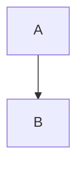

# markora-extension-diagrams

Optional semantic diagram fences for embedded Markora editors. The package recognizes the four case-sensitive GitHub fenced-code kinds `mermaid`, `geojson`, `topojson`, and `stl`, keeps their complete normalized info string and body as editable model data, and can show host-rendered previews without bundling a renderer.

## Install and use

```bash
npm install markora markora-extension-diagrams
```

Minimal-entry consumers should import `markora/minimal.css` in place of `markora/styles.css` below.

```ts
import { createEditor } from "markora";
import { createDiagramsExtension } from "markora-extension-diagrams";
import "markora/styles.css";
import "markora-extension-diagrams/styles.css";

const diagrams = createDiagramsExtension({
  renderers: {
    mermaid: async ({ source, ownerDocument, signal }) => {
      const svg = await renderMermaidToDetachedSvg(source, { ownerDocument, signal });
      return svg; // Node or DocumentFragment; never an HTML string
    },
  },
});

const editor = createEditor({
  element: document.querySelector<HTMLElement>("#editor")!,
  extensions: [diagrams],
  markdown: "```mermaid theme=neutral\ngraph TD; A-->B\n```",
});

const handle = editor.extensions.get(diagrams);
const first = handle.state.getNodes("mermaid")[0];
if (first) handle.commands.togglePreview(first);
```

The same extension definition works with `markora/minimal`. Keep `editor.extensions.manifest` beside persisted Markdown so a later editor loads the same syntax before editing.

## Syntax and fidelity

The first whitespace-delimited token of the trimmed fence info must be exactly one of:

````md


```geojson viewport=fit
{"type":"Point","coordinates":[0,0]}
```
````

Matching is case-sensitive. `Mermaid`, `plantuml`, and `json mermaid` remain ordinary code blocks. The model retains the full normalized info (`geojson viewport=fit`, not only `geojson`) and the complete normalized body. CommonMark parsing normalizes line endings to LF, replaces NUL with U+FFFD, removes the fence's structural final line break, and canonicalizes delimiter spelling. Authored backtick/tilde choice, indentation, and fence length are not exact-source data.

Serialization uses a safe generic fence. It chooses tildes when the info contains a backtick and otherwise uses backticks, then makes the delimiter longer than every same-delimiter run in the body. A body delimiter can therefore never close the output early. Without this package, root and minimal retain these forms as ordinary normalized code blocks.

Diagram nodes are real code textblocks, not source atoms. Native selection, editing, IME, Markdown paste, history, and code-body clipboard behavior remain available in source mode. Derived preview DOM never enters Markdown, history, clipboard serialization, or extension storage.

## Public workflow

`handle.commands` provides:

- `insert({ info, source })`
- `convert(target, kind)` while retaining the info suffix
- `convertCodeBlock(kind)` for the selected generic code block
- `restoreCodeBlock(target)`
- `update(target, { info?, source? })`
- `remove(target)`, `togglePreview(target)`, and `retryPreview(target)`

Snapshots are immutable stale-safe targets carrying an occurrence identity, position, kind, info, and source. A successful info or source change, including a kind change, produces a new identity; old targets return `false`. Commands also return `false` for semantic no-ops, read-only editors, and active composition.

`handle.state` exposes diagnostics, nodes, kind, render state, and the combined snapshot. Combined UTF-8 `info + newline + body` source over the 262,144-byte rendering bound stays editable and serializes unchanged; the renderer is skipped and a recoverable diagnostic is reported.

Use `onEditSource(request)` to open a host editor. Its bound `convert`, `update`, `restoreCodeBlock`, and `remove` methods stop working as soon as that occurrence changes, resets, reconciles, disappears, or the editor is destroyed.

## Renderer boundary

`renderers` is a partial kind map. A kind with no callback remains in source mode. Each callback receives an immutable request:

```ts
type DiagramRenderRequest = Readonly<{
  kind: "mermaid" | "geojson" | "topojson" | "stl";
  info: string;
  source: string;
  ownerDocument: Document;
  signal: AbortSignal;
}>;
```

Return a detached `Node` or `DocumentFragment` owned by `ownerDocument`. Strings, `TrustedHTML`, connected nodes, foreign-document nodes, and shadow roots are rejected. Markora never calls an HTML string sink. Render work starts outside transactions and synchronous typing, activates near the viewport, caps each editor runtime at four callbacks, and aborts stale generations after edits, kind changes, preview deactivation, reset/reconciliation, removal, or teardown.

The final non-bypassable clamp manually copies a bounded static HTML/SVG allowlist into fresh DOM. It supports common inert Mermaid structure, classes, safe presentation attributes/styles, and local SVG IDs/references. Every accepted ID is replaced with a unique extension-owned ID; local `url(#id)` and `<use href="#id">` references are rewritten to it. Duplicate, missing, or external references are rejected, preventing collisions across diagrams and editors.

The clamp rejects scripts, stylesheets and `<style>`, `foreignObject`, custom elements, forms, frames, images/media, animation/event SVG, event attributes, external links/loads, CSS network URLs, indirect `var()`/`env()`/`attr()` values, and unsupported namespaces. It bounds 4,096 nodes, depth 128, 64 attributes per element, and 1 MiB of copied output. Mermaid hosts should configure static SVG output without HTML labels (`foreignObject`) or animation. Renderer-specific CSS and renderer auditing remain host responsibilities; trusted host and ancestor CSS still has application authority, and safe editor preview does not make serialized Markdown safe for downstream HTML publication.

## Accessibility and styling

The source shell always exposes the localized diagram kind, complete info string, and body to assistive technology, including while a visual preview is selected. Arrow or Shift+Arrow navigation across an adjacent block boundary reveals the real editable source before moving the selection into it. Boundary direction follows the first or last plaintext line using Unicode bidi P3 semantics, defaults neutral lines to LTR, and preserves combining and ZWJ grapheme clusters across LTR, RTL, and mixed multiline blocks. Preview DOM is inert and `aria-hidden`; it is never the sole representation of authored source. Package controls are keyboard-invokable, read-only/composition aware, and use localized messages.

The explicit stylesheet uses logical properties, wraps at narrow embedded widths, and includes forced-colors/reduced-motion behavior. Hosts may override `--mdw-diagram-*` custom properties and own renderer-specific SVG styling, typography, `lang`, and `dir` through the editor embed.

## Activation boundary

Installing the package changes matching fences from core `code_block` nodes to semantic `diagram` nodes, while canonical Markdown stays a generic safe fence. Install it before importing documents that use this syntax and store the extension manifest. Without it, serialized documents parse as ordinary code blocks and do not expose preview state or semantic diagram APIs.
